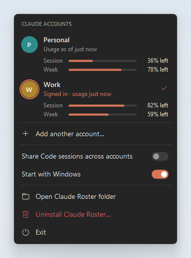
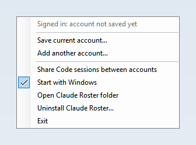
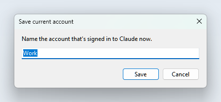
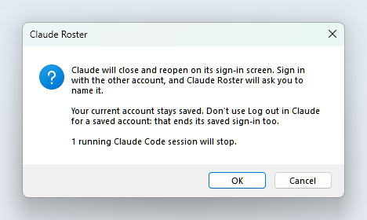
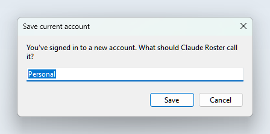
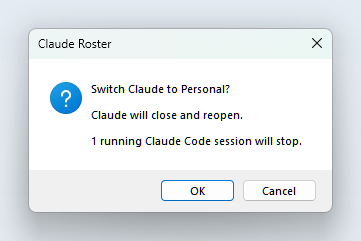
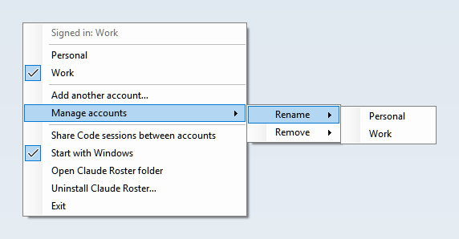

<p align="center">
  
</p>

<h1 align="center">Claude Roster</h1>

<p align="center">
  <b>Switch the Claude desktop app between your accounts, right from Claude's title bar.</b><br>
  Save your work and personal accounts once, then switch with a click instead of logging out and back in, and see how much of each plan's usage is left.
</p>

<p align="center">
  
  
  
  <a href="https://github.com/RathaTart/claude-roster/releases/latest"></a>
  <a href="LICENSE"></a>
</p>

<p align="center">
  
  <br>
  <sub>The account panel. The ✓ marks the account Claude is signed in to; click another one to switch. The bars show how much of each plan limit is left.</sub>
</p>

> [!NOTE]
> Claude Roster is an unofficial community tool. It isn't affiliated with or endorsed by Anthropic.

## Features

- **Switch from inside Claude.** An account button sits at the top left of Claude's window, next to its back and forward arrows, and follows the window when you move it. It shows who's signed in and how much of the session limit is left. Click it to open the account panel.
- **One-click switching.** Claude closes, swaps to the other account's sign-in, and reopens. It takes a few seconds.
- **See usage left for every account.** The panel shows the session (5-hour) and weekly limits left for each saved account, from the readings Claude itself records.
- **Saved sign-ins stay fresh.** Claude refreshes its tokens while you work, so every switch first copies the account you're leaving.
- **Hard to lose an account.** It backs up before every switch and rolls back automatically if anything fails. It refuses to switch away from an account you haven't saved, or from a sign-in it can't read.
- **Your setup comes with you.** Skills, plugins you installed, hooks, settings and memory live in `~\.claude`, so every account uses the same ones.
- **Optionally share Claude Code sessions.** By default each account sees its own sessions in the Code tab. Turn on sharing and every account lists them all.
- **Local only.** No network calls and no telemetry. Saved sign-ins stay on your PC, readable only by your Windows user.
- **Scriptable.** A `claude-roster` command line covers everything the tray menu does.
- **Clean uninstall.** One menu item removes Claude Roster, its saved accounts and its startup entry, and leaves Claude signed in.

## Requirements

- Windows 10 or 11 (x64)
- The Claude desktop app: the Microsoft Store version (tested) or the classic installer
- The [.NET 9 Desktop Runtime](https://dotnet.microsoft.com/download/dotnet/9.0), which comes with the .NET 9 SDK

## Install

**[Download ClaudeRoster.exe](https://github.com/RathaTart/claude-roster/releases/latest/download/ClaudeRoster.exe)** from the latest release. Save it in a permanent folder and double-click it in File Explorer. There's no installer.

The [release page](https://github.com/RathaTart/claude-roster/releases/latest) also has the `claude-roster.exe` command line, a ZIP with both programs plus the README and license, and `SHA256SUMS.txt` to verify any download:

```powershell
Get-FileHash .\ClaudeRoster.exe -Algorithm SHA256
```

> [!NOTE]
> Releases aren't code-signed, so the first launch may show **Windows protected your PC**. Check the file's hash against `SHA256SUMS.txt`, then choose **More info → Run anyway**. Prefer to build it yourself? See [Build from source](#build-from-source).

The icon appears in the system tray next to the clock. On Windows 11 it may be hidden under the **^** arrow. To keep it on the taskbar, open **Settings → Personalization → Taskbar → Other system tray icons** and turn **ClaudeRoster** on.

**You only need to start it once.** From then on it starts with Windows, waits out of sight, and its icon and the account button in Claude appear whenever Claude is open. To change that, use **Start with Windows** in its menu.

> [!IMPORTANT]
> Start Claude Roster from File Explorer or the Start menu, **not from a terminal inside a Claude Code session**. Switching closes Claude, which would also stop anything started from inside it. Claude Roster detects this and refuses to switch.

## How to use

There are three ways in, all with the same choices:

- **The account button** at the top left of Claude's window opens the account panel.
- **Left-click the tray icon** for the same panel.
- **Right-click the tray icon** for a classic menu, shown in the pictures below.

The panel follows your Windows light or dark app theme.

### 1. Save the account you're signed in to

The first time, Claude Roster shows that Claude's account isn't saved yet. Choose **Save current account…** and give it a name.

<table>
  <tr>
    <td valign="top"></td>
    <td valign="top"></td>
  </tr>
</table>

### 2. Add your other account

Choose **Add another account…**. Claude closes and reopens on its sign-in screen. Sign in with the other account, and Claude Roster asks you to name it.

<table>
  <tr>
    <td valign="top"></td>
    <td valign="top"></td>
  </tr>
</table>

### 3. Switch

Click an account and confirm. Claude closes and reopens signed in as that account. The confirmation tells you if any Claude Code sessions are running, because they stop when Claude closes.

<p></p>

### See how much usage is left

Each account in the panel shows two bars: what's left of the **session** (5-hour) limit and of the **weekly** limit. They turn amber below 25% and red below 10%. The account button in Claude shows the session figure, and hovering it shows both.

- The numbers come from `plan-usage-history.json`, where Claude records your plan usage. Claude Roster reads that file and makes no network calls.
- Claude records readings per organization, not per account, so each account gets the readings taken while it was the one signed in.
- An account you're not signed in to shows its last reading and how old it is. Once 5 hours (session) or 7 days (weekly) have passed since then, that limit has reset, so it shows as fully available.
- Some plans have no limits for Claude to report. Those accounts show **No usage limits reported**.

### Share Claude Code sessions between accounts (optional)

Claude keeps a separate Code-tab session list for each account. Turn on **Share Code sessions** in the panel or menu, and each switch makes every account's list the same:

- Sessions started in either account show up in both, and you can continue any of them from either.
- The most recently changed copy of a session wins, so renames and archiving carry over.
- A session you delete in one account is deleted in the other.
- Both lists are backed up before every merge, in the same `backups\` folder as sign-ins.

Only the session list is shared. The conversations themselves already live in `~\.claude`, which every account uses. claude.ai connectors and plugins that come from an account or its organisation stay with that account, so a shared session may not have them all.

> [!CAUTION]
> Continuing a shared session sends that conversation through the account you're signed in to. If one account belongs to your employer, check its policy before letting work sessions into a personal account. Turning sharing off stops new copies; sessions already copied stay in both accounts.

### Rename or remove

In the panel, hover an account and click **⋯**. In the classic menu, use **Manage accounts**. Removing an account only deletes its saved sign-in on this PC; the Claude account itself isn't affected. You can't remove the account that's signed in right now.

<p></p>

### Good to know

> [!WARNING]
> **Don't use Claude's own Log out for a saved account.** Logging out ends that session on Anthropic's side, so the saved copy stops working too. To add or change accounts, use **Add another account…** instead.

- **Running Claude Code sessions stop when you switch**, because Claude closes. They're still there when you switch back.
- **The account button stays with Claude.** It sits just above Claude's window, so other apps cover it like they cover Claude. It hides while Claude is minimized, closed to the tray or on another virtual desktop. Turn it off with **Show account button in Claude**.
- **Start with Windows** is turned on the first time Claude Roster runs. It adds an entry under `HKCU\Software\Microsoft\Windows\CurrentVersion\Run`. When started that way, Claude Roster stays hidden until Claude opens, and hides again after Claude quits (never in the middle of a switch). Turn it off in the menu and it stays off. Starting `ClaudeRoster.exe` yourself always shows the icon.
- **The terminal `claude` CLI isn't covered.** It keeps its own login in `~\.claude`. To use a second account there, give it a separate config folder: `$env:CLAUDE_CONFIG_DIR = "$HOME\.claude-personal"; claude`.
- **Work accounts follow work rules.** If one of your accounts belongs to an employer, check its policy on personal AI accounts on work machines. Each account stays under its own plan, limits and terms.

## How it works

The Claude desktop app is an Electron app. Its sign-in lives in a handful of files in its data folder. Claude Roster copies exactly those in and out, and leaves everything else alone.

Newer versions of Claude keep that folder in `%LOCALAPPDATA%\Claude-Data\<install id>`. Older ones used `%APPDATA%\Claude`, or the Store package's `LocalCache`. When Claude moves its data, it leaves a `.user-data-left.<install id>` marker in the old folder. Claude Roster follows that marker and never uses a folder Claude has left. `claude-roster status` shows which folder is in use.

<details>
<summary><b>What gets saved and swapped</b></summary>

<br>

| Saved per account | Why |
| --- | --- |
| `Network\Cookies` | the claude.ai session |
| `Local Storage`, `Session Storage`, `IndexedDB`, `WebStorage`, `blob_storage` | claude.ai's local state for that account |
| `Local State` | the key that encrypts the cookies and tokens; each saved copy keeps the key its data was encrypted with |
| `config.json` keys `oauth:*`, `lastKnownAccountUuid`, `bootSidebarPlaceholder` | Claude Code tokens, the account id, and the cached sidebar |

**Left alone:** app settings, MCP servers, extensions, caches, and Claude Code sessions. Claude already keeps Code sessions in a separate folder per account; only [session sharing](#share-claude-code-sessions-between-accounts-optional), if you turn it on, copies session files between those folders.

Run `claude-roster plan` to see this list with sizes for your own install. It changes nothing.

</details>

<details>
<summary><b>What happens during a switch</b></summary>

<br>

1. Check that the account signed in now is saved. If it isn't, stop, so it can't be lost.
2. Close Claude. It asks politely first, then force-closes after a few seconds, because Claude keeps running in the tray. Only the desktop app's own `Claude.exe` processes are touched, never a `claude.exe` CLI.
3. Back up the live sign-in to `backups\`. The last 5 backups are kept.
4. Copy the live sign-in into the profile it belongs to, so its saved copy has the latest tokens.
5. Put the target account's sign-in in place. If this fails, the backup is restored.
6. Reopen Claude and wait for its window. If Claude quits before showing one, Claude Roster launches it once more, then tells you if it still didn't start.

Accounts are recognised by Claude's `lastKnownAccountUuid`. If Claude holds tokens but that id can't be read (for example, after an update changes the format), Claude Roster refuses to switch rather than guess.

</details>

## Privacy and security

Everything is stored under `%APPDATA%\ClaudeRoster`. The folder is restricted to your Windows user, SYSTEM and Administrators.

| Path | Contents |
| --- | --- |
| `profiles.json` | account names and ids, no secrets |
| `profiles\<id>\session\` | each account's saved sign-in |
| `backups\` | the live sign-in, plus the session lists when sharing is on, from before each of the last 5 switches |
| `shared-sessions.json` | which sessions each account had at the last merge, so deletions carry over |

> [!CAUTION]
> **Treat saved sign-ins like passwords.** Don't sync this folder to cloud storage, share it, or attach it to a bug report. Anyone who can read it as your Windows user can use those sessions. The encryption is tied to your Windows account, so the files don't work on another PC or for another user.

Claude Roster makes no network requests and sends nothing anywhere.

### Uninstall

Choose **Uninstall Claude Roster…** in the panel or the classic menu, and confirm. It:

1. Deletes `%APPDATA%\ClaudeRoster`: every saved sign-in and backup. If that fails, it stops and removes nothing else, so you can try again.
2. Turns off Start with Windows and deletes `HKCU\Software\ClaudeRoster`.
3. Quits, then deletes `ClaudeRoster.exe`, `claude-roster.exe` if it's in the same folder, and that folder if nothing else is left in it.

Claude's own data isn't touched. Claude stays signed in to its current account, and your Claude Code sessions stay. To use your other accounts again, sign in to them in Claude.

To uninstall by hand instead: turn off **Start with Windows**, choose **Exit**, then delete `ClaudeRoster.exe`, `%APPDATA%\ClaudeRoster` and the registry key `HKCU\Software\ClaudeRoster`.

## Command line

`claude-roster.exe` drives the same logic from a terminal. [Download it](https://github.com/RathaTart/claude-roster/releases/latest/download/claude-roster.exe) from the latest release, or build it from source.

| Command | What it does |
| --- | --- |
| `claude-roster status` | what Claude is signed in to right now |
| `claude-roster list` | saved accounts (`*` = signed in) and their usage left |
| `claude-roster plan` | dry run: what a switch copies |
| `claude-roster save <name>` | save the account Claude is signed in to |
| `claude-roster switch <name>` | close Claude, swap accounts, reopen |
| `claude-roster add` | save the current account, then open Claude's sign-in screen |
| `claude-roster share on\|off` | share Claude Code sessions between accounts on each switch |
| `claude-roster rename <name> <new>` | rename a saved account |
| `claude-roster remove <name>` | forget a saved account (not the signed-in one) |

`status`, `list` and `plan` are read-only. `switch`, `add` and `remove` ask first; pass `--yes` to skip the prompt.

```text
> claude-roster status
Claude data     C:\Users\you\AppData\Local\Claude-Data\anthropicpbc.claude_fnn82j28hfe8t
Store package   AnthropicPBC.Claude_fnn82j28hfe8t
Claude running  yes, 1 Claude Code session(s) open
Signed in       Work (11111111…)
Saved accounts  2
Share sessions  off
Roster data     C:\Users\you\AppData\Roaming\ClaudeRoster

> claude-roster list
  Personal                 22222222…
                           Session 100% left · Week 78% left (2 days ago)
* Work                     11111111…
                           Session 82% left · Week 59% left (4 min ago)
```

## Build from source

Needs the [.NET 9 SDK](https://dotnet.microsoft.com/download/dotnet/9.0).

```powershell
git clone https://github.com/RathaTart/claude-roster.git
```

```powershell
dotnet test claude-roster\ClaudeRoster.sln -c Release
```

```powershell
dotnet publish claude-roster\src\ClaudeRoster -c Release -r win-x64 --self-contained false -p:PublishSingleFile=true -p:DebugType=none -o claude-roster\publish
```

```powershell
dotnet publish claude-roster\src\ClaudeRoster.Cli -c Release -r win-x64 --self-contained false -p:PublishSingleFile=true -p:DebugType=none -o claude-roster\publish
```

Both programs end up in `claude-roster\publish`.

| Project | What it is |
| --- | --- |
| `src/ClaudeRoster.Core` | finding Claude, snapshots, process control, the switch sequence, plan usage |
| `src/ClaudeRoster` | the tray app (WinForms): tray icon, account panel, and the button on Claude's title bar |
| `src/ClaudeRoster.Cli` | `claude-roster.exe` |
| `tests/ClaudeRoster.Tests` | xUnit tests against fake Claude data folders; they never touch the real one |
| `tools/Screenshots` | regenerates the images in `docs/images` with sample accounts |

The tests and the screenshot tool run on throwaway data. For manual testing, `CLAUDE_ROSTER_CLAUDE_DATA` points Claude Roster at a different Claude data folder, and `CLAUDE_ROSTER_HOME` sets where it keeps its own data.

## Limitations

- Claude's sign-in storage isn't a documented interface, so a Claude update can change it. When that happens, expect Claude Roster to refuse to switch rather than corrupt anything; the storage list in `SessionSnapshotter` and `ClaudeConfig` then needs updating.
- One account is active at a time. It doesn't run two Claude windows side by side.
- The account button is placed for Claude's current title bar layout, beside the back and forward arrows. If a Claude update moves those, the button may need repositioning (the offsets are at the top of `TitleBarButton.cs`).
- Usage is only as fresh as Claude's last reading. The file format isn't documented either; if it changes, accounts simply show no usage.
- The panel and button follow the Windows app theme. Claude's own appearance setting can't be read from outside.
- The Microsoft Store install is tested. The classic installer (`%LOCALAPPDATA%\AnthropicClaude`) is supported by path rules but hasn't been tested.

## Credits

- The approach follows [roster-companion](https://github.com/tanagornf/roster-companion) by tanagornf, which does the same job for the ChatGPT desktop app.

## License

[MIT](LICENSE) © 2026 RathaTart
